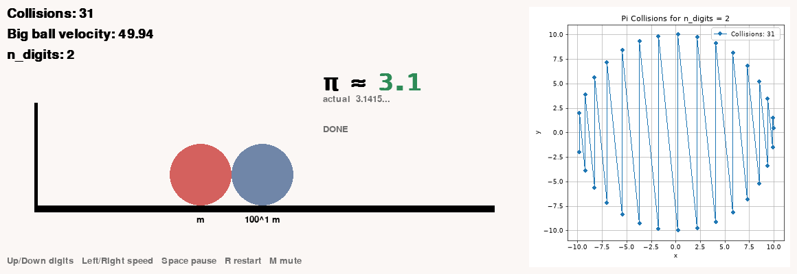

# Calculating Pi Through Elastic Collisions
This is a final project for my computational physics class in the Fall Semester of 2024. My partner and I took inspiration from 3Blue1Brown's video "The Most Unexpected Answer to a counting puzzle," which explores how two objects colliding with each other in an elastic setting can calculate pi. Using the conservation of energy and momentum formula, we were able to derive the velocity and dynamically plot the point using Matplotlib to showcase a circle after our collisions. We did everything from scratch but the graphics. Although this method is highly inefficient, it is a fun project. 

## Running it

```bash
python3 -m venv .venv
source .venv/bin/activate
pip install -r requirements.txt
python PHY300_Final.py        # optional: number of digits, e.g. python PHY300_Final.py 7
```

| Key | Action |
|---|---|
| Up / Down | More / fewer digits of pi (1–8), restarts the run |
| Left / Right | Slow down / speed up time (0.1x – 4x) |
| Space | Pause / resume |
| R | Restart |
| M | Mute / unmute |
| Esc | Quit |



## Why the answer is pi (the phase-space panel)

Plot each state as the point (x, y) = (√M·v_big, √m·v_small). Kinetic energy ½Mv_big² + ½mv_small² is conserved, so every point lies on a circle. On that circle:

- a **wall bounce** flips v_small, so it is a vertical jump;
- a **ball-ball collision** conserves momentum, so it moves along a line of slope −√(M/m).

Each collision moves the point the same angle around the circle (2θ for every collision pair, θ = arctan√(m/M)), until both balls move right with the big one faster, so they can never meet again. The number of steps that fit is ⌊π/θ⌋-ish, and with M/m = 100^(n−1), θ ≈ 10^−(n−1), giving the first n digits of π.

The panel next to the simulation draws this plot live, in the same matplotlib style as our original notebook images: each collision adds a point and a line segment the moment it happens, and the legend counts up with it. Matplotlib renders the axes once per run, and pygame draws the data on top using matplotlib's own coordinate transform, so it keeps up at 60 fps. For n ≥ 6 it plots every k-th collision (about 20,000 points), since there are millions.

## Files

- `PHY300_Final.py` - The pygame visualization: the collision count is read live as digits of pi, which turn green once the run finishes and they match.
- `phase_panel.py` - The live phase-space plot (matplotlib-style) drawn beside the simulation.
- `pi_collisions.py` - The physics engine. It is event-driven: rather than stepping time forward in tiny increments and checking for overlaps (which let the fast small ball tunnel through the big one and lose collisions from n = 4 up), it solves for the exact moment of each next collision and jumps straight to it. Compiled with numba, it counts 31,415,926 collisions (n = 8) in under a tenth of a second. Run `python pi_collisions.py` for a timing table.
- `tests/` - Checks that the collision counts match the digits of pi, that energy is conserved, and that the balls never pass through each other. Run with `python -m pytest`.
- `Phase_Space.ipynb` - Jupyter notebook that graphs all the points by running a simulation itself. Multiple cells that do the same thing.
- `assets/boop.mp3` - the sound made when objects collide.
- `assets/pieImage.jpg` - the window icon.
- `assets/screenshot.png` - the screenshot above.

